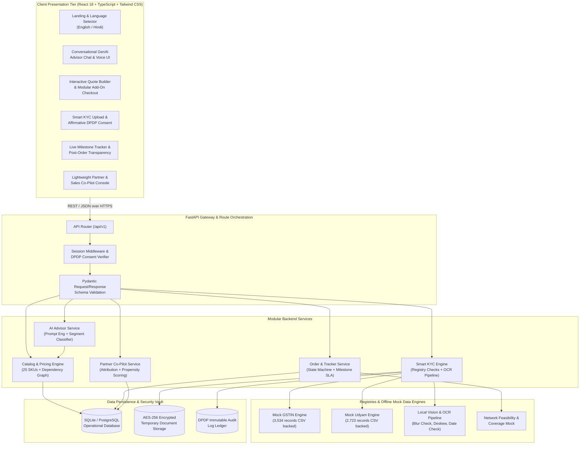
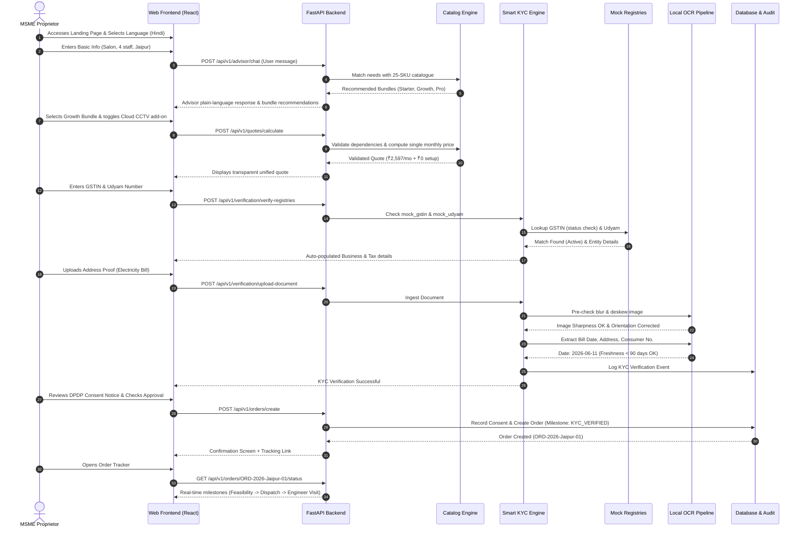

# Solution Architecture Document
## Project Udyam Digital: High-Scale MSME Acquisition & Onboarding Platform

**Competition:** Airtel SYNC 2026 — Digital Track  
**Document Version:** 1.0 (Implementation-Ready Blueprint)  
**Status:** Approved for Technical Implementation  

---

## 1. Architectural Philosophy & Core Principles

The architectural design of **Project Udyam Digital** is governed by practical engineering principles tailored to the hackathon evaluation requirements and real-world enterprise scalability:

1. **Modular Monolithic Backend over Premature Microservices:**
   - Rather than introducing operational overhead, distributed transaction complexities, and inter-service latency, the backend is architected as a **Modular Monolith** in Python FastAPI.
   - Modules (Advisor, Catalog, KYC, Orders, Partner) communicate via clean internal interfaces and service layers, allowing effortless extraction into separate microservices if future production scale warrants.
2. **Provider-Agnostic AI & Resilient Local Fallbacks:**
   - The GenAI conversational advisor is built behind a pluggable **Adapter Interface**.
   - Supports live enterprise LLMs (Gemini, Claude, OpenAI) while providing a **100% deterministic local rule-based engine** when external API keys are unavailable. The application never breaks or stalls.
3. **Self-Contained Local OCR & Verification Engine:**
   - In accordance with DPDP Act 2023 principles, KYC documents and PII are never transmitted to external cloud computer vision APIs.
   - Uses local image preprocessing (sharpness check via Laplacian variance, deskewing) and structured regex extraction, backed by a deterministic test harness supporting all `K01`–`K12` edge cases.
4. **Zero-Config Local Deployment with Cloud Portability:**
   - SQLite with SQLAlchemy ORM enables instant, zero-setup local demonstration without external database dependencies.
   - Complete schema compatibility with PostgreSQL ensures production readiness for containerized cloud deployment (Docker / Render / Railway).

---

## 2. System Component Architecture



---

## 3. End-to-End Onboarding Sequence Flow



---

## 4. Component Deep Dive

### 4.1 Frontend Architecture (`frontend/`)
- **Framework:** React 18 with TypeScript for type safety and fast component reusability.
- **Styling:** Tailwind CSS implementing the official Airtel corporate color token palette:
  - Primary Brand Red: `#E40000` (Airtel Red)
  - Secondary Accent Dark: `#1F2937`
  - Success Indicator: `#10B981`
  - Warning / Alert: `#F59E0B`
  - Background Neutral: `#F9FAFB`
- **State Management:** React Context API + lightweight local state hooks for seamless step-by-step wizard navigation.
- **Internationalization (i18n):** Extensible dictionary architecture supporting bilingual English and Hindi strings with immediate toggle switching without page reloads.

### 4.2 Backend Modular Monolith (`backend/`)
- **Framework:** Python FastAPI running on Uvicorn ASGI server.
- **Modules & Responsibilities:**
  1. `routers/advisor.py`: Conversational endpoints, chat history, and bundle generation.
  2. `routers/catalog.py`: 25-product catalogue ingestion, rule validation, and quote calculation.
  3. `routers/kyc.py`: GSTIN/Udyam registry queries, document file handling, and OCR validation.
  4. `routers/orders.py`: Order persistence, state machine milestone progression, and tracking queries.
  5. `routers/partner.py`: Partner attribution links, recovery queue, and propensity scoring.
  6. `services/ocr_engine.py`: Image quality assessment, blur detection, deskewing, and field extraction.
  7. `services/rules_engine.py`: Hard catalogue dependency checker and pricing aggregator.
  8. `services/consent_vault.py`: DPDP Act 2023 consent logging and PII masking filters.

### 4.3 Data Storage & Caching
- **Relational Database:** SQLite (local mode) via SQLAlchemy ORM.
  - Zero setup requirements for testing.
  - Clean migration capability to PostgreSQL for enterprise production.
- **In-Memory Cache:** Fast indexed lookup dictionaries for `mock_gstin_registry.csv` and `mock_udyam_registry.csv`, delivering <5ms response times.

---

## 5. Technology Stack Rationale

| Layer | Chosen Technology | Evaluated Alternative | Decisive Rationale |
| :--- | :--- | :--- | :--- |
| **Frontend** | React 18 + TypeScript | Next.js / Vue | Standard, robust ecosystem, rapid client-side SPA routing, zero server-rendering overhead for local demo. |
| **Styling** | Tailwind CSS | CSS Modules / MUI | Rapid mobile-first responsive layout, fine-grained Airtel red brand theming, zero runtime CSS bloat. |
| **Backend** | Python FastAPI | Django / Node.js Express | High-performance asynchronous execution, native OpenAPI/Swagger docs, seamless integration with Python OCR & data libraries. |
| **Database** | SQLite + SQLAlchemy | MongoDB / PostgreSQL only | Zero configuration needed for local evaluation; SQLAlchemy abstraction allows instantaneous switch to PostgreSQL. |
| **Advisor AI** | LLM Adapter + Rule Fallback | Cloud-Only LLM API | Allows demonstration using live Gemini/Claude when keys exist, while guaranteeing 100% offline uptime via deterministic rules. |
| **OCR Engine** | Local Vision Pipeline + OpenCV | Tesseract / Google Vision API | No external cloud cost; no PII leakage; fully handles blur pre-checks, deskewing, and regex parsing offline. |
| **Packaging** | Docker & Docker Compose | Manual virtualenv only | Single-command cross-platform reproducibility on any evaluator machine. |

---

## 6. Deployment Architecture

```
┌─────────────────────────────────────────────────────────────────────────────┐
│                       DEPLOYMENT TOPOLOGY MATRIX                            │
├─────────────────────┬───────────────────────────────────────────────────────┤
│ Environment         │ Configuration & Topology                              │
├─────────────────────┼───────────────────────────────────────────────────────┤
│ 1. Local Dev / Demo │ Single-command run script (./run_local.sh)            │
│    (Self-Contained) │ FastAPI backend (port 8000) + React Vite (port 3000)  │
│                     │ SQLite database; 100% offline operational             │
├─────────────────────┼───────────────────────────────────────────────────────┤
│ 2. Docker Container │ Multi-stage Dockerfile packaging frontend build into  │
│    (Reproducible)   │ FastAPI static mount or reverse-proxied via Nginx.   │
│                     │ docker-compose up --build                             │
├─────────────────────┼───────────────────────────────────────────────────────┤
│ 3. Cloud Staging    │ Automated deployment to Render / Railway / Cloud Run. │
│    (Public Demo)    │ HTTPS secured; zero cold-start optimization.          │
└─────────────────────┴───────────────────────────────────────────────────────┘
```

